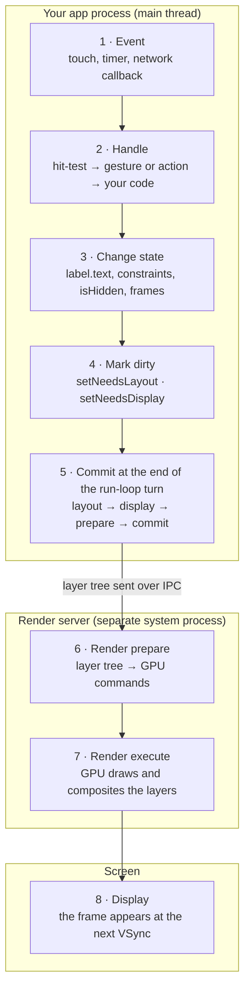
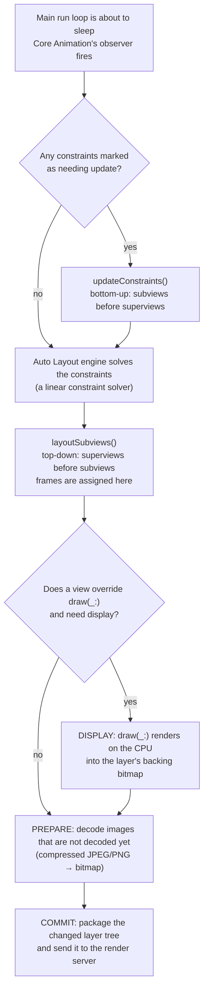
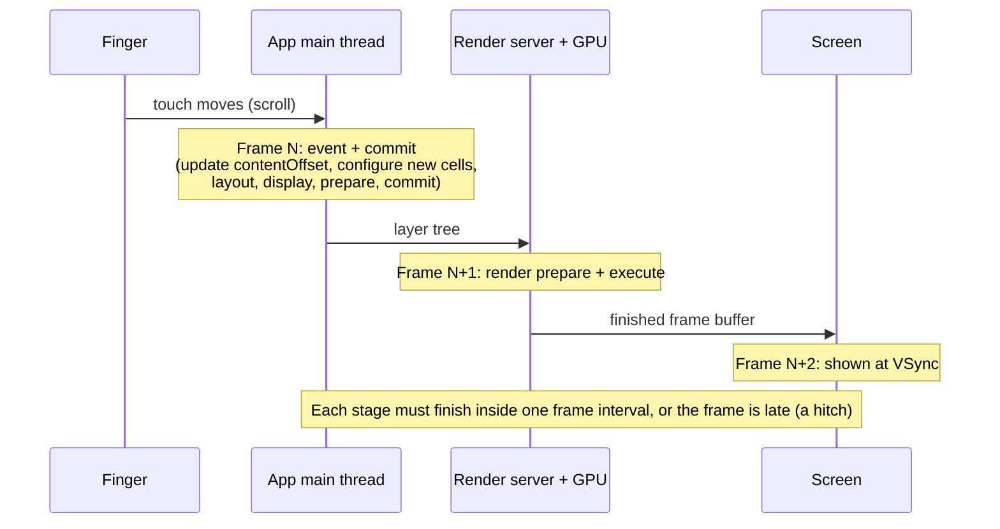
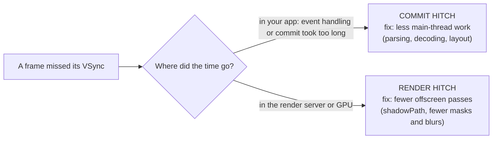

# 10 · Performance and the render pipeline

[← Index](../README.md) · [← Security](09-security.md) · [Next: Devtools →](11-devtools.md)

## How a frame gets on screen

| Topic | |
|---|---|
| [10.0.1 The big picture](#1001-the-big-picture) | the 8 steps from touch to pixels |
| [10.0.2 The key players](#1002-the-key-players) | UIView, CALayer, the three layer trees, run loop, render server |
| [10.0.3 Step by step](#1003-step-by-step) | what happens in each step and what slows it down |
| [10.0.4 Inside the commit phase](#1004-inside-the-commit-phase) | layout → display → prepare → commit |
| [10.0.5 Frame timing and hitches](#1005-frame-timing-and-hitches) | frame budget, VSync, commit vs render hitches |
| [10.0.6 Compared with React and the browser](#1006-compared-with-react-and-the-browser) | the mental model you already have |

### 10.0.1 The big picture



You only control **steps 1–5**, in your own process. Steps 6–8 happen in a **system render server** and on the GPU. So your app can't draw pixels directly: it describes a tree of layers, and the system turns that description into a frame.

### 10.0.2 The key players

| Player | What it is | Why you care |
|---|---|---|
| `UIView` | handles touches, layout, accessibility; owns one `CALayer` | you work here 95% of the time |
| `CALayer` | the visual part: position, bounds, background, border, shadow, `contents` (a bitmap) | shadows, corners, masks and animations are layer properties |
| Model layer tree | the values **you** set (`view.alpha = 0.5`) | what you read back in code |
| Presentation tree | the values **on screen right now** during an animation (`layer.presentation()`) | hit-testing a moving view, interrupting animations |
| Render tree | the render server's private copy | it's why animations keep running while your main thread is busy |
| Main run loop | the loop on the main thread that waits for events and runs your code | everything UI happens here, one turn at a time |
| Core Animation (`CATransaction`) | batches all layer changes made in one run-loop turn | 10 property changes = 1 commit = 1 frame |
| Render server | a system process that composites every app's layers with the GPU | your commit must reach it in time |
| Display (VSync) | the screen refreshes at a fixed rhythm (60 or up to 120 Hz) | a frame that misses its VSync is a **hitch** |

### 10.0.3 Step by step

**1 · Event.**
- A finger touches the glass and the system delivers a `UIEvent` to your app's main run loop.
- Timers, network callbacks that hop to the main queue, and `CADisplayLink` ticks also arrive here.

**2 · Handle: hit-testing and the responder chain.**
- **Hit-testing:** `UIWindow` calls `hitTest(_:with:)` and walks **down** the view tree to the deepest view containing the touch point. It skips views that are hidden, have `alpha < 0.01`, or have `isUserInteractionEnabled == false`.
- **Gesture recognizers first:** they get the touches before the view does.
- **Responder chain:** if nothing handles the event, it travels **up** the chain: view → superview → view controller → window → application.
- **Tip:** a button that "doesn't work" is usually inside a parent that is too small (the touch falls outside it) or has `isUserInteractionEnabled = false`. Check it with the View Debugger.

**3 · Change state.** Your handler runs: `balanceLabel.text = "$1,250.50"`, `heightConstraint.constant = 300`, `spinner.startAnimating()`.
- **Changes are recorded, not drawn.** Core Animation opens an implicit `CATransaction` and records each change. Nothing is drawn yet.
- **Speed matters here:** this step must be quick. Heavy JSON parsing or image decoding at this point delays everything after it.

**4 · Mark dirty.** Changes that affect geometry or content mark views as needing work. They batch until the end of the run-loop turn:

| Call | Meaning | Runs |
|---|---|---|
| `setNeedsUpdateConstraints()` | constraints must be recalculated | next commit |
| `setNeedsLayout()` | frames must be recalculated | next commit |
| `setNeedsDisplay()` | `draw(_:)` must run again (custom drawing only) | next commit |
| `layoutIfNeeded()` | **do pending layout now**, synchronously | immediately |

**5 · Commit.** Just before the main run loop goes to sleep, a Core Animation observer fires and commits the transaction: **layout → display → prepare → commit** (detailed in [10.0.4](#1004-inside-the-commit-phase)).
- **What gets sent:** the result is a compact description of the changed layer tree, sent to the render server over inter-process communication.
- **What it costs:** the cost grows with the number of changed layers and the amount of layout work.

**6 · Render prepare** (render server). The server merges your changes into its render tree. It works out drawing order and decides which layers need **offscreen passes**: rendering into a separate texture first, which is slower.

**7 · Render execute** (GPU). The GPU draws and composites all the layers (yours, the status bar, system UI) into a frame buffer.
- **Most expensive:** blur (`UIVisualEffectView`), masks, shadows **without** a `shadowPath`, and many overlapping translucent layers.

**8 · Display.** At the next VSync the screen swaps to the new frame buffer.
- **Buffering:** the system uses double buffering (one buffer shown, one being drawn). It can switch to triple buffering to recover when it falls behind.

> **Animations are special.** `UIView.animate` and `CAAnimation` send the *start and end values* to the render server once, and the server works out every frame itself. That's why a spinner keeps spinning while your main thread is busy for a moment, but **scrolling freezes**: scrolling needs your main thread every frame (new `contentOffset`, new cells).

### 10.0.4 Inside the commit phase



| Phase | What happens | Typical problem | Fix |
|---|---|---|---|
| Layout | `updateConstraints` (bottom-up) → solver → `layoutSubviews` (top-down) | deep stack-view nesting in every cell; constraints added/removed on every update; `layoutIfNeeded()` called in loops | flatten hierarchies; create constraints once and change `constant`; pre-calculate heights |
| Display | `draw(_:)` for views that override it | overriding `draw(_:)` for things a layer can do (corners, borders); an empty `draw(_:)` still allocates a bitmap | use layer properties, `UIImageView`, `CAShapeLayer`; don't override `draw(_:)` unless needed |
| Prepare | images are decoded the first time they're shown | big photos decoded on the main thread during scroll | decode early: `UIImage.byPreparingForDisplay()`, `preparingThumbnail(of:)`, or an image library |
| Commit | layer tree encoded and sent | thousands of layers; many layers changing every frame | fewer layers; reuse cells; avoid changing everything on each tick |

### 10.0.5 Frame timing and hitches



| Refresh rate | Frame interval (your budget per stage) |
|---|---|
| 60 Hz | 16.67 ms |
| 120 Hz (ProMotion) | 8.33 ms |

- **Normal latency:** even with nothing slow, a touch takes a couple of frames to reach the screen, because commit and render happen in consecutive frame intervals.
- **ProMotion** iPhones change the refresh rate dynamically (up to 120 Hz). For your own `CADisplayLink` animations above 60 Hz on iPhone, set `CADisableMinimumFrameDurationOnPhone` to `YES` in `Info.plist` and request a rate with `preferredFrameRateRange`.



- **Measuring:** Apple's metric is the **hitch time ratio**: milliseconds of hitches per second of scrolling or animation. Under 5 ms/s is good; 5–10 ms/s is noticeable; 10 ms/s or more is bad.
- **Tools:** Instruments → **Animation Hitches** (on a real device). It shows whether each hitch was a commit hitch or a render hitch.
- **In production:** the Xcode Organizer's scrolling metrics and MetricKit report the same measurement from real users.

### 10.0.6 Compared with React and the browser

| React + browser | UIKit + Core Animation |
|---|---|
| `setState` → React re-renders components | you set properties directly (no virtual DOM, no diff) |
| reconciliation (diff) → commit to the DOM | `CATransaction` batches the changes made in one run-loop turn |
| DOM | layer tree |
| style → layout → paint → composite | layout (`layoutSubviews`) → display (`draw(_:)`) → prepare → commit → render server composites |
| compositor thread (CSS transforms keep animating while JS is busy) | render server (Core Animation animations keep running while the main thread is busy) |
| layout thrashing (read `offsetHeight` after every write) | calling `layoutIfNeeded()` / `systemLayoutSizeFitting` repeatedly in loops |
| FlatList virtualization | cell reuse in `UICollectionView` / `UITableView` |

SwiftUI views end up on screen through the same Core Animation pipeline, so everything on this page applies to SwiftUI too.

---

## 10.1 Formatters in cells

**Why it matters:**
- `NumberFormatter` and `DateFormatter` are expensive to create.
- Creating one inside `cellForRowAt` runs it for every row, while scrolling, on the main thread.

### ❌ Bad

<!-- example: examples/10-performance/01-formatter-bad.swift -->
```swift
// ❌ BAD: creating an expensive formatter for every row (often inside cellForRowAt)
// Run: swift examples/10-performance/01-formatter-bad.swift
import Foundation

let amounts = (1...20_000).map { Decimal($0) / 100 }

let start = ContinuousClock.now
var texts: [String] = []
for amount in amounts {
    let formatter = NumberFormatter()                 // ❌ a new formatter per row
    formatter.numberStyle = .currency
    formatter.currencyCode = "USD"
    formatter.locale = Locale(identifier: "en_US")
    texts.append(formatter.string(from: NSDecimalNumber(decimal: amount)) ?? "")
}
let elapsed = ContinuousClock.now - start

print("first row:", texts[0], "| last row:", texts[texts.count - 1])
print("20,000 rows took \(elapsed.formatted(.units(allowed: [.milliseconds])))")
```

**Output** (numbers change on every run)

```text
first row: $0.01 | last row: $200.00
20,000 rows took 1,404 ms
```
<!-- /example -->

### ✅ Good

<!-- example: examples/10-performance/01-formatter-good.swift -->
```swift
// ✅ GOOD: create the formatter once and reuse it (or use FormatStyle, which Foundation caches for you)
// Run: swift examples/10-performance/01-formatter-good.swift
import Foundation

let amounts = (1...20_000).map { Decimal($0) / 100 }

enum Formatters {
    static let usd: NumberFormatter = {
        let formatter = NumberFormatter()
        formatter.numberStyle = .currency
        formatter.currencyCode = "USD"
        formatter.locale = Locale(identifier: "en_US")
        return formatter
    }()
}

var start = ContinuousClock.now
let shared = amounts.map { Formatters.usd.string(from: NSDecimalNumber(decimal: $0)) ?? "" }
print("shared NumberFormatter: \((ContinuousClock.now - start).formatted(.units(allowed: [.milliseconds])))")

start = ContinuousClock.now
let style = Decimal.FormatStyle.Currency(code: "USD", locale: Locale(identifier: "en_US"))
let styled = amounts.map { $0.formatted(style) }
print("FormatStyle:            \((ContinuousClock.now - start).formatted(.units(allowed: [.milliseconds])))")

print("same text?", shared == styled ? "yes" : "no", "| first row:", styled[0], "| last row:", styled[styled.count - 1])
```

**Output** (numbers change on every run)

```text
shared NumberFormatter: 32 ms
FormatStyle:            82 ms
same text? yes | first row: $0.01 | last row: $200.00
```
<!-- /example -->

Even better: format **once** when building ViewData ([04 · 4.2](04-networking-and-data.md#42-dto--domain--viewdata)), not in the cell.

---

## 10.2 Shadows and offscreen rendering (🍎 snippet)

```swift
// ❌ BAD: the GPU must work out the shadow shape from the layer's content every frame
card.layer.shadowOpacity = 0.2
card.layer.shadowRadius = 8

// ✅ GOOD: tell it the shape, and update the path when the size changes
override func layoutSubviews() {
    super.layoutSubviews()
    layer.shadowOpacity = 0.2
    layer.shadowRadius = 8
    layer.shadowPath = UIBezierPath(roundedRect: bounds, cornerRadius: 12).cgPath
}
```

Find these with Simulator → **Debug → Color Offscreen-Rendered** (yellow = offscreen) and Instruments → **Animation Hitches**.

---

## Checklist for smooth scrolling

- [ ] No formatter creation, JSON parsing or image decoding on the main thread during scroll.
- [ ] Cells get pre-built ViewData; `configure(with:)` only assigns values.
- [ ] Images are downsampled to the display size; downloads are cancelled in `prepareForReuse`.
- [ ] Shadows have a `shadowPath`; avoid `masksToBounds` + shadow on the same layer.
- [ ] Profile on a **real device** (the Simulator uses your Mac's CPU).

---

## Alternatives and trade-offs

| Need | Option | ✅ Strengths | ⚠️ Trade-offs |
|---|---|---|---|
| Number/date formatting | `FormatStyle` | value type, `Sendable`, thread-safe, short code | in this guide's Linux run it was slower than a reused `NumberFormatter`, so measure on device |
| Number/date formatting | one shared `NumberFormatter` / `DateFormatter` | fast when reused | don't mutate it from several threads; easy to recreate by mistake |
| Number/date formatting | format once into ViewData | nothing to do while scrolling | slightly more memory |
| Image decoding | `UIImage.byPreparingForDisplay()` / `preparingThumbnail(of:)` | decode off the main thread, built-in (iOS 15+) | you manage caching |
| Image decoding | Nuke / Kingfisher | caching, downsampling, prefetching | dependency |
| Layout cost | Auto Layout | adaptive, standard | solver cost in very complex cells |
| Layout cost | manual frames / PinLayout | fastest | more code, Dynamic Type by hand |
| Measuring | Instruments (Time Profiler, Animation Hitches) | precise, free | needs a Mac and a device |
| Measuring | MetricKit / Firebase Performance / Sentry | real users in production | sampling delays, privacy review |

---

[← Index](../README.md) · [← Security](09-security.md) · [Next: Devtools →](11-devtools.md)
