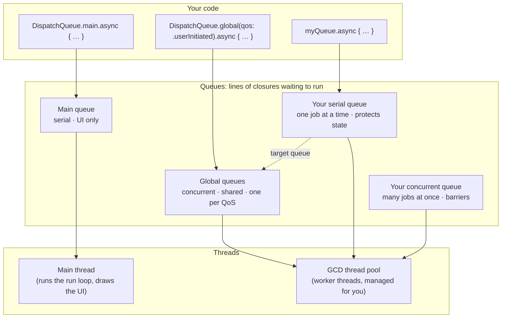

# 15 · GCD (Grand Central Dispatch) deep dive

[← Index](../README.md) · [← Concurrency overview](03-concurrency.md) · [Next: Patterns from Telegram →](16-patterns-from-telegram.md)

New code uses `async/await` ([03](03-concurrency.md)), but **most existing banking codebases are built on GCD**, and interviewers love GCD questions. This page shows how GCD works, the classic bugs (run them!), and the correct patterns.

| Topic | Bad | Good |
|---|---|---|
| [15.1 How GCD works](#151-how-gcd-works) | 👀 explore | – |
| [15.2 sync deadlock](#152-sync-onto-your-own-queue-deadlock) | `sync` onto your own queue | sync once, `dispatchPrecondition` |
| [15.3 Thread-safe state](#153-thread-safe-state-serial-queue-or-barrier) | concurrent queue alone | barrier writes (reader-writer) |
| [15.4 DispatchGroup](#154-dispatchgroup-enter-and-leave) | `leave()` skipped on error | `defer { group.leave() }` |
| [15.5 Semaphores](#155-semaphores-never-block-the-main-thread) | `wait()` on the main thread | react to the callback |
| [15.6 Blocking threads](#156-dont-block-gcd-threads) | sleeping or blocking inside GCD | non-blocking APIs, `OperationQueue` limit |
| [15.7 Debounce](#157-debounce-with-dispatchworkitem) | one search per keystroke | `DispatchWorkItem` + `cancel()` |

---

## 15.1 How GCD works

GCD (`libdispatch`) owns a **pool of threads**. You never create threads yourself. Instead you put **closures** on **queues**, and GCD picks a thread to run them.



### Queues

| Queue | Kind | Use it for | Never |
|---|---|---|---|
| `DispatchQueue.main` | serial, always the **main thread** | updating UI | slow work (JSON parsing, image decoding, `sleep`) |
| `DispatchQueue.global(qos:)` | concurrent, shared by the whole app | independent background jobs | barriers (they don't work here); blocking calls |
| `DispatchQueue(label:)` | **serial**, yours | protecting state; ordered work (e.g. writing a log file) | `sync` onto itself ([15.2](#152-sync-onto-your-own-queue-deadlock)) |
| `DispatchQueue(label:attributes: .concurrent)` | concurrent, yours | parallel reads + barrier writes ([15.3](#153-thread-safe-state-serial-queue-or-barrier)) | assuming it protects state without barriers |

### sync vs async

| | `async` | `sync` |
|---|---|---|
| Caller | continues immediately | **waits** until the closure has run |
| Typical use | "do this later / elsewhere" | read a value protected by a queue |
| Danger | forgetting to hop back to main for UI | **deadlock** when the target queue is the current one, or is waiting on you |
| On the main thread | `DispatchQueue.main.async` from a background thread = the classic "update UI" hop | `DispatchQueue.main.sync` **from** main = instant deadlock |

### Quality of Service (QoS): how urgent is the work?

| QoS | Meaning | Banking example |
|---|---|---|
| `.userInteractive` | must finish this frame | animation math (usually just do it on main) |
| `.userInitiated` | the user is **waiting** for it | loading the screen they just opened |
| `.default` | not specified | – |
| `.utility` | long-running, user may see progress | downloading a statement PDF |
| `.background` | the user doesn't notice | prefetching, cleaning caches, uploading logs |

**Priority inversion:** high-priority work waiting on a lock or a `sync` held by `.background` work runs as slowly as the background work. Don't make user-facing code wait on background queues.

### 👀 Explore

<!-- example: examples/15-gcd/01-queues-explore.swift -->
```swift
// 👀 EXPLORE: serial vs concurrent queues, sync vs async: watch the order of the prints
// Run: swift examples/15-gcd/01-queues-explore.swift
import Foundation

let serial = DispatchQueue(label: "com.mybank.serial")                                    // one job at a time, in order
let concurrent = DispatchQueue(label: "com.mybank.concurrent", attributes: .concurrent)  // many jobs at once

print("1. Serial queue: jobs run one after another, in the order you add them")
for job in 1...3 {
    serial.async { print("   serial job \(job)") }
}
serial.sync {}                                       // wait until the jobs above are done

print("2. Concurrent queue: jobs overlap, so the shortest one finishes first")
let group = DispatchGroup()
for (job, milliseconds) in [(1, 300), (2, 100), (3, 200)] {
    concurrent.async(group: group) {
        Thread.sleep(forTimeInterval: Double(milliseconds) / 1000)   // pretend work
        print("   concurrent job \(job) finished after \(milliseconds) ms")
    }
}
group.wait()

print("3. async returns immediately; sync waits until the job has run")
serial.async {
    Thread.sleep(forTimeInterval: 0.05)
    print("   async job (ran later)")
}
print("   line after async")
serial.sync { print("   sync job") }
print("   line after sync")
```

**Output**

```text
1. Serial queue: jobs run one after another, in the order you add them
   serial job 1
   serial job 2
   serial job 3
2. Concurrent queue: jobs overlap, so the shortest one finishes first
   concurrent job 2 finished after 100 ms
   concurrent job 3 finished after 200 ms
   concurrent job 1 finished after 300 ms
3. async returns immediately; sync waits until the job has run
   line after async
   async job (ran later)
   sync job
   line after sync
```
<!-- /example -->

---

## 15.2 sync onto your own queue (deadlock)

**Why it matters:**
- **The trap:** a serial queue runs one job at a time. If a job on queue Q calls `Q.sync { … }`, the new job waits for the current job to finish, but the current job is waiting for the new one. Nothing can ever move.
- **How it happens:** almost always one method calling another method that also syncs.
- **On iOS:** the crash log says `BUG IN CLIENT OF LIBDISPATCH: dispatch_sync called on queue already owned by current thread`.
- **The worse version:** two queues syncing onto *each other* aren't detected at all. The app just freezes.

### ❌ Bad

<!-- example: examples/15-gcd/02-sync-deadlock-bad.swift -->
```swift
// ❌ BAD: calling queue.sync while already running on that same serial queue → it waits for itself forever
// Run: swift examples/15-gcd/02-sync-deadlock-bad.swift
import Foundation

final class BalanceCache: @unchecked Sendable {                 // state protected by a serial queue
    private let queue = DispatchQueue(label: "com.mybank.balance-cache")
    private var balances: [String: String] = [:]

    func balance(for account: String) -> String? {
        queue.sync { balances[account] }
    }

    func update(_ account: String, to value: String) {
        queue.sync {
            balances[account] = value
            print("saved \(account), reading it back…")
            print("value:", balance(for: account) ?? "nil")   // ❌ balance(for:) calls queue.sync AGAIN
        }
    }
}

BalanceCache().update("000123456", to: "$1,250.50")
print("never printed")
```

**Output**

```text
saved 000123456, reading it back…
💥 (the app crashes here; stack trace omitted)
```
<!-- /example -->

### ✅ Good

<!-- example: examples/15-gcd/02-sync-deadlock-good.swift -->
```swift
// ✅ GOOD: public methods hop onto the queue ONCE; private helpers assume they're already on it (and check it)
// Run: swift examples/15-gcd/02-sync-deadlock-good.swift
import Foundation

final class BalanceCache: @unchecked Sendable {
    private let queue = DispatchQueue(label: "com.mybank.balance-cache")
    private var balances: [String: String] = [:]

    func balance(for account: String) -> String? {
        queue.sync { storedBalance(for: account) }
    }

    func update(_ account: String, to value: String) {
        queue.sync {
            balances[account] = value
            print("saved \(account), reading it back…")
            print("value:", storedBalance(for: account) ?? "nil")   // ✅ no second sync
        }
    }

    /// Must only be called while already on `queue`.
    private func storedBalance(for account: String) -> String? {
        dispatchPrecondition(condition: .onQueue(queue))            // stops in debug if called from elsewhere
        return balances[account]
    }
}

let cache = BalanceCache()
cache.update("000123456", to: "$1,250.50")
print("from outside:", cache.balance(for: "000123456") ?? "nil")
// Even simpler in new code: make BalanceCache an `actor` (see docs/03-concurrency.md), and this bug can't happen.
```

**Output**

```text
saved 000123456, reading it back…
value: $1,250.50
from outside: $1,250.50
```
<!-- /example -->

---

## 15.3 Thread-safe state: serial queue or barrier

Ways to protect shared mutable state (a cache, a counter, the current token):

| Tool | How | Notes |
|---|---|---|
| **Serial queue** | all reads and writes through `queue.sync` / `queue.async` | simplest GCD answer ([15.2](#152-sync-onto-your-own-queue-deadlock)) |
| **Concurrent queue + barrier** | reads: `queue.sync { }` run in parallel; writes: `queue.async(flags: .barrier) { }` run alone | "reader-writer"; good when reads are much more frequent |
| Lock (`NSLock`, `OSAllocatedUnfairLock` iOS 16+, `Mutex` iOS 18+) | `lock.withLock { }` | fastest for tiny critical sections; never hold a lock across `await` |
| **`actor`** | the compiler enforces it | the modern answer ([03 · 3.4](03-concurrency.md#34-shared-mutable-state)) |

### ❌ Bad: a concurrent queue doesn't protect anything by itself

<!-- example: examples/15-gcd/03-concurrent-queue-bad.swift -->
```swift
// ❌ BAD: a CONCURRENT queue protects nothing by itself: writes overlap and updates are lost
// Run: swift examples/15-gcd/03-concurrent-queue-bad.swift
import Foundation

final class TransactionCounter: @unchecked Sendable {
    private let queue = DispatchQueue(label: "com.mybank.counter", attributes: .concurrent)
    private var count = 0

    func increment() { queue.async { self.count += 1 } }          // ❌ many writes at the same time
    var value: Int { queue.sync { count } }
}

let counter = TransactionCounter()
DispatchQueue.concurrentPerform(iterations: 10_000) { _ in counter.increment() }
Thread.sleep(forTimeInterval: 0.5)                                // let the writes finish
print("expected 10000, got \(counter.value)")
```

**Output** (numbers change on every run)

```text
expected 10000, got 9949
```
<!-- /example -->

### ✅ Good: barrier writes

<!-- example: examples/15-gcd/03-concurrent-queue-good.swift -->
```swift
// ✅ GOOD: reader-writer pattern: reads run together with sync, writes run ALONE with a barrier
// Run: swift examples/15-gcd/03-concurrent-queue-good.swift
import Foundation

final class TransactionCounter: @unchecked Sendable {
    private let queue = DispatchQueue(label: "com.mybank.counter", attributes: .concurrent)  // must be YOUR queue
    private var count = 0

    func increment() { queue.async(flags: .barrier) { self.count += 1 } }   // ✅ waits for readers, runs alone
    var value: Int { queue.sync { count } }                                 // many readers can run at once
}

let counter = TransactionCounter()
DispatchQueue.concurrentPerform(iterations: 10_000) { _ in counter.increment() }
print("expected 10000, got \(counter.value)")
// ⚠️ .barrier does nothing special on DispatchQueue.global(): it only works on a custom concurrent queue.
```

**Output**

```text
expected 10000, got 10000
```
<!-- /example -->

---

## 15.4 DispatchGroup: enter and leave

A group runs a closure (`notify`) when all tracked jobs have finished. It's the GCD version of `async let` / `Promise.all`; see [03 · 3.3](03-concurrency.md#33-parallel-requests) for the timing example.

**Rule:** every `enter()` needs **exactly one** `leave()`.
- **Too few** → `notify` never fires (the spinner never stops).
- **Too many** → crash (`Unbalanced call to dispatch_group_leave()`).

### ❌ Bad

<!-- example: examples/15-gcd/04-group-leave-bad.swift -->
```swift
// ❌ BAD: leave() is skipped on the error path → the group never finishes → the spinner never stops
// Run: swift examples/15-gcd/04-group-leave-bad.swift
import Foundation

struct Offline: Error {}

func fetch(_ name: String, failing: Bool, completion: @escaping @Sendable (Result<String, any Error>) -> Void) {
    DispatchQueue.global().asyncAfter(deadline: .now() + (failing ? 0.2 : 0.1)) {
        completion(failing ? .failure(Offline()) : .success(name))
    }
}

let group = DispatchGroup()
for (name, failing) in [("accounts", false), ("cards", true)] {
    group.enter()
    fetch(name, failing: failing) { result in
        guard case .success(let value) = result else { return }   // ❌ returns without leave()
        print("loaded \(value)")
        group.leave()
    }
}

// (A script may wait. In an app, use group.notify(queue: .main) and never wait on the main thread.)
if group.wait(timeout: .now() + 2) == .timedOut {
    print("2 s later: still waiting for 'cards' → the home screen spinner never stops")
}
// Calling leave() MORE times than enter() is worse: the app crashes ("Unbalanced call to dispatch_group_leave()").
```

**Output**

```text
loaded accounts
2 s later: still waiting for 'cards' → the home screen spinner never stops
```
<!-- /example -->

### ✅ Good

<!-- example: examples/15-gcd/04-group-leave-good.swift -->
```swift
// ✅ GOOD: `defer { group.leave() }` as the FIRST line → leave() runs exactly once on every path
// Run: swift examples/15-gcd/04-group-leave-good.swift
import Foundation

struct Offline: Error {}

func fetch(_ name: String, failing: Bool, completion: @escaping @Sendable (Result<String, any Error>) -> Void) {
    DispatchQueue.global().asyncAfter(deadline: .now() + (failing ? 0.2 : 0.1)) {
        completion(failing ? .failure(Offline()) : .success(name))
    }
}

let group = DispatchGroup()
for (name, failing) in [("accounts", false), ("cards", true)] {
    group.enter()
    fetch(name, failing: failing) { result in
        defer { group.leave() }                                    // ✅ always
        switch result {
        case .success(let value): print("loaded \(value)")
        case .failure(let error): print("⚠️ \(name) failed (\(error)) → show a 'Try again' row")
        }
    }
}

group.notify(queue: .main) {
    print("everything finished → hide the spinner")
    exit(0)
}
dispatchMain()
```

**Output**

```text
loaded accounts
⚠️ cards failed (Offline()) → show a 'Try again' row
everything finished → hide the spinner
```
<!-- /example -->

---

## 15.5 Semaphores: never block the main thread

**Why it matters:**
- **The idea:** a `DispatchSemaphore` makes a thread *wait* until another thread signals. People use it to turn async code into "synchronous" code.
- **The deadlock:** on the main thread, the result is often delivered *to the main queue*, which is blocked by the wait.
- **The freeze:** even without a deadlock, the UI is frozen while waiting.

### ❌ Bad

<!-- example: examples/15-gcd/05-semaphore-main-bad.swift -->
```swift
// ❌ BAD: blocking the MAIN thread with a semaphore to make async code "synchronous"
// Run: swift examples/15-gcd/05-semaphore-main-bad.swift
import Foundation

func fetchBalance(completion: @escaping @Sendable (String) -> Void) {
    DispatchQueue.global().asyncAfter(deadline: .now() + 0.2) {
        DispatchQueue.main.async { completion("$1,250.50") }    // delivers on the main queue, as UI code should
    }
}

print("Home screen asks for the balance and waits…")
let semaphore = DispatchSemaphore(value: 0)
fetchBalance { balance in
    print("got \(balance)")                                       // never runs: main is blocked below
    semaphore.signal()
}

if semaphore.wait(timeout: .now() + 2) == .timedOut {            // real code often uses .distantFuture
    print("💀 2 s and nothing: main waits for the completion, the completion waits for main (deadlock)")
    print("   with no timeout the screen freezes; at launch, iOS's watchdog kills the app with crash code 0x8badf00d")
}
```

**Output**

```text
Home screen asks for the balance and waits…
💀 2 s and nothing: main waits for the completion, the completion waits for main (deadlock)
   with no timeout the screen freezes; at launch, iOS's watchdog kills the app with crash code 0x8badf00d
```
<!-- /example -->

### ✅ Good

<!-- example: examples/15-gcd/05-semaphore-main-good.swift -->
```swift
// ✅ GOOD: never block the main thread: react when the result arrives (or bridge to async/await, see docs/03)
// Run: swift examples/15-gcd/05-semaphore-main-good.swift
import Foundation

func fetchBalance(completion: @escaping @Sendable (String) -> Void) {
    DispatchQueue.global().asyncAfter(deadline: .now() + 0.2) {
        DispatchQueue.main.async { completion("$1,250.50") }
    }
}

print("Home screen shows a spinner and keeps responding…")
fetchBalance { balance in
    print("✅ got \(balance) → hide spinner, show balance")
    exit(0)
}

DispatchQueue.main.asyncAfter(deadline: .now() + 0.1) {
    print("   (the user scrolls: the UI still responds while we wait)")
}
dispatchMain()
```

**Output**

```text
Home screen shows a spinner and keeps responding…
   (the user scrolls: the UI still responds while we wait)
✅ got $1,250.50 → hide spinner, show balance
```
<!-- /example -->

> **Never** call `semaphore.wait()` inside `async` code either. Swift Concurrency's thread pool is small, and blocking it can stall the whole app. Use `withCheckedThrowingContinuation` ([03 · 3.2](03-concurrency.md#32-asyncawait-and-bridging-old-apis)).

---

## 15.6 Don't block GCD threads

**Why it matters:**
- **The problem:** a thread stuck in a blocking call (`sleep`, a synchronous network or SDK call, `semaphore.wait()`, `group.wait()`) can't do anything else.
- **On iOS:** GCD reacts by creating *more* threads, up to about 64. That's **thread explosion**: memory per thread, context switching, and eventually starvation.
- **The fix:** use non-blocking APIs (`URLSession` calls you back). For work that really blocks, cap it with an `OperationQueue`.

### ❌ Bad

<!-- example: examples/15-gcd/06-blocking-threads-bad.swift -->
```swift
// ❌ BAD: blocking GCD threads while "waiting for the network"
// On iOS, GCD reacts by creating more and more threads (up to about 64): "thread explosion"
// → memory use, context switching, jank. Linux's GCD is more conservative, so here it's simply very slow.
// Run: swift examples/15-gcd/06-blocking-threads-bad.swift
import Foundation

// Counts how many jobs run at the same time (demo helper)
final class Peak: @unchecked Sendable {
    private let lock = NSLock()
    private var running = 0
    private var maximum = 0

    func start() { lock.lock(); running += 1; maximum = max(maximum, running); lock.unlock() }
    func finish() { lock.lock(); running -= 1; lock.unlock() }
    var peak: Int { lock.lock(); defer { lock.unlock() }; return maximum }
}

func seconds(_ duration: Duration) -> String {
    let value = Double(duration.components.seconds) + Double(duration.components.attoseconds) / 1e18
    return String(format: "%.1f", value)
}

let peak = Peak()
let group = DispatchGroup()
let start = ContinuousClock.now

for _ in 0..<100 {
    DispatchQueue.global().async(group: group) {
        peak.start()
        Thread.sleep(forTimeInterval: 0.2)          // ❌ a blocking "request": this thread can do nothing else
        peak.finish()
    }
}
group.wait()
print("100 blocking requests took \(seconds(ContinuousClock.now - start)) s, \(peak.peak) threads stuck waiting at once")
```

**Output** (numbers change on every run)

```text
100 blocking requests took 3.4 s, 8 threads stuck waiting at once
```
<!-- /example -->

### ✅ Good

<!-- example: examples/15-gcd/06-blocking-threads-good.swift -->
```swift
// ✅ GOOD: use non-blocking APIs (URLSession calls you back; no thread waits),
//          and cap truly blocking work with OperationQueue.maxConcurrentOperationCount
// Run: swift examples/15-gcd/06-blocking-threads-good.swift
import Foundation

// Counts how many jobs run at the same time (demo helper)
final class Peak: @unchecked Sendable {
    private let lock = NSLock()
    private var running = 0
    private var maximum = 0

    func start() { lock.lock(); running += 1; maximum = max(maximum, running); lock.unlock() }
    func finish() { lock.lock(); running -= 1; lock.unlock() }
    var peak: Int { lock.lock(); defer { lock.unlock() }; return maximum }
}

func seconds(_ duration: Duration) -> String {
    let value = Double(duration.components.seconds) + Double(duration.components.attoseconds) / 1e18
    return String(format: "%.1f", value)
}

// 1. Non-blocking: the "network" calls back later, like URLSession does
func fakeRequest(completion: @escaping @Sendable () -> Void) {
    DispatchQueue.global().asyncAfter(deadline: .now() + 0.2, execute: completion)
}

var start = ContinuousClock.now
let group = DispatchGroup()
for _ in 0..<100 {
    group.enter()
    fakeRequest { group.leave() }
}
group.wait()
print("100 non-blocking requests took \(seconds(ContinuousClock.now - start)) s")

// 2. Work that really blocks (e.g. an old SDK's synchronous upload): limit how many run at once
let uploads = OperationQueue()
uploads.maxConcurrentOperationCount = 2
let peak = Peak()
start = ContinuousClock.now
for _ in 1...6 {
    uploads.addOperation {
        peak.start()
        Thread.sleep(forTimeInterval: 0.2)        // pretend synchronous upload of one KYC page
        peak.finish()
    }
}
uploads.waitUntilAllOperationsAreFinished()
print("6 blocking uploads, at most \(peak.peak) at once, took \(seconds(ContinuousClock.now - start)) s")
```

**Output** (numbers change on every run)

```text
100 non-blocking requests took 0.2 s
6 blocking uploads, at most 2 at once, took 0.6 s
```
<!-- /example -->

---

## 15.7 Debounce with DispatchWorkItem

**Why it matters:** search-as-you-type without debouncing sends an API call per keystroke, and old results can overwrite new ones. A `DispatchWorkItem` can be **cancelled**, which makes it the classic GCD debounce. The async/await version is in the [component catalog](14-uikit-components.md#uisearchcontroller).

### ❌ Bad

<!-- example: examples/15-gcd/07-debounce-bad.swift -->
```swift
// ❌ BAD: every keystroke schedules its own search → 4 API calls for one word, results can arrive out of order
// Run: swift examples/15-gcd/07-debounce-bad.swift
import Foundation

@MainActor
final class SearchViewController {
    private var searchCount = 0

    func searchTextChanged(_ text: String) {
        DispatchQueue.main.asyncAfter(deadline: .now() + 0.3) { self.search(text) }   // ❌ never cancelled
    }

    private func search(_ text: String) {
        searchCount += 1
        print("🔎 API search #\(searchCount) for \"\(text)\"")
    }
}

DispatchQueue.main.async {                                          // UI code runs on the main queue
    let screen = SearchViewController()
    for (index, text) in ["c", "co", "cof", "coff"].enumerated() {  // the user types one letter every 100 ms
        DispatchQueue.main.asyncAfter(deadline: .now() + Double(index) * 0.1) { screen.searchTextChanged(text) }
    }
    DispatchQueue.main.asyncAfter(deadline: .now() + 1.2) {
        withExtendedLifetime(screen) { exit(0) }   // keep the screen alive, like a navigation stack would
    }
}
dispatchMain()
```

**Output**

```text
🔎 API search #1 for "c"
🔎 API search #2 for "co"
🔎 API search #3 for "cof"
🔎 API search #4 for "coff"
```
<!-- /example -->

### ✅ Good

<!-- example: examples/15-gcd/07-debounce-good.swift -->
```swift
// ✅ GOOD: debounce with DispatchWorkItem: cancel the pending search on every keystroke
// Run: swift examples/15-gcd/07-debounce-good.swift
import Foundation

@MainActor
final class SearchViewController {
    private var pendingSearch: DispatchWorkItem?
    private var searchCount = 0

    func searchTextChanged(_ text: String) {
        pendingSearch?.cancel()                               // ✅ still typing → drop the old search
        let item = DispatchWorkItem { [weak self] in
            MainActor.assumeIsolated { self?.search(text) }   // the work item runs on the main queue
        }
        pendingSearch = item
        DispatchQueue.main.asyncAfter(deadline: .now() + 0.3, execute: item)
    }

    private func search(_ text: String) {
        searchCount += 1
        print("🔎 API search #\(searchCount) for \"\(text)\"")
    }
}

DispatchQueue.main.async {                                          // UI code runs on the main queue
    let screen = SearchViewController()
    for (index, text) in ["c", "co", "cof", "coff"].enumerated() {  // the user types one letter every 100 ms
        DispatchQueue.main.asyncAfter(deadline: .now() + Double(index) * 0.1) { screen.searchTextChanged(text) }
    }
    DispatchQueue.main.asyncAfter(deadline: .now() + 1.2) {
        withExtendedLifetime(screen) { exit(0) }   // keep the screen alive, like a navigation stack would
    }
}
dispatchMain()
// async/await version: cancel a Task and use Task.sleep (see docs/14-uikit-components.md#uisearchcontroller)
```

**Output**

```text
🔎 API search #1 for "coff"
```
<!-- /example -->

---

## More GCD you'll meet in real code

| API | Use it for | Tip |
|---|---|---|
| `asyncAfter(deadline:)` | delays (toast dismiss, retry back-off) | can't be cancelled; use `DispatchWorkItem` if you might cancel |
| `DispatchWorkItem` | cancellable work; `notify(queue:)` when done | `cancel()` only prevents work that hasn't **started** |
| `DispatchQueue.concurrentPerform(iterations:)` | CPU-heavy loops in parallel (e.g. processing images) | blocks the caller until done, so not from main |
| `DispatchSource.makeTimerSource` | a precise repeating or one-shot timer (session timeout) | keep a strong reference; call `resume()`; `cancel()` when done |
| `dispatchPrecondition(condition:)` | assert you're on (or not on) a queue | stops in debug builds only; cheap documentation |
| target queues | funnel many serial queues into one | rarely needed in app code |
| `static let shared = …` | thread-safe lazy creation | Swift does this for you (it replaced `dispatch_once`) |

Inactivity auto-logout with a dispatch timer (🍎 snippet, not run):

```swift
final class SessionTimer {
    private let timer = DispatchSource.makeTimerSource(queue: .main)
    private let timeout: TimeInterval = 300                       // 5 minutes

    init(onExpire: @escaping () -> Void) {
        timer.setEventHandler(handler: onExpire)
        timer.schedule(deadline: .now() + timeout)
        timer.resume()
    }

    func userDidSomething() {                                    // call on every touch / screen change
        timer.schedule(deadline: .now() + timeout)                // restart the countdown
    }

    deinit { timer.cancel() }
}
```

## GCD ↔ Swift Concurrency cheat sheet

| GCD | Swift Concurrency |
|---|---|
| `DispatchQueue.main.async { }` | `@MainActor` / `await MainActor.run { }` |
| `DispatchQueue.global().async { }` | `Task.detached { }` (rarely needed) or just an `async` function |
| serial queue protecting state | `actor` |
| `DispatchGroup` | `async let` / `withTaskGroup` |
| `DispatchSemaphore` to limit concurrency | a task group that adds only N child tasks at a time |
| `DispatchWorkItem.cancel()` | `Task.cancel()` + `Task.isCancelled` / `Task.checkCancellation()` |
| `asyncAfter` | `try await Task.sleep(for:)` |
| completion handler API | wrap once with `withCheckedThrowingContinuation` |

**Mixing rule:** inside `async` code, never block (`sync` onto busy queues, `semaphore.wait()`, `group.wait()`). Bridge with continuations instead.

## Interview questions

<details>
<summary><b>Serial vs concurrent queue?</b></summary>

A serial queue runs one closure at a time, in order, which makes it good for protecting state. A concurrent queue can run many at once, so it's good for independent work, or reader-writer with barriers. The main queue is serial. → [15.1](#151-how-gcd-works)
</details>

<details>
<summary><b>sync vs async? When does sync deadlock?</b></summary>

`async` returns immediately; `sync` waits. It deadlocks when you `sync` onto the queue you're already on, e.g. `DispatchQueue.main.sync` from the main thread, or a serial queue syncing onto itself. It also deadlocks when two queues sync onto each other. → [15.2](#152-sync-onto-your-own-queue-deadlock)
</details>

<details>
<summary><b>How do you make a property thread-safe?</b></summary>

- **Serial queue:** sync reads and async writes.
- **Concurrent queue:** sync reads and `.barrier` writes on your own queue.
- **A lock**, for tiny critical sections.
- **In new code, an `actor`.**

Mention that `.barrier` does nothing on global queues. → [15.3](#153-thread-safe-state-serial-queue-or-barrier)
</details>

<details>
<summary><b>DispatchGroup vs DispatchSemaphore?</b></summary>

A group waits for **N jobs to finish** (`notify` or `wait`). A semaphore is a **counter of permits**, used to limit concurrency or signal between threads. Never use either to block the main thread. → [15.4](#154-dispatchgroup-enter-and-leave), [15.5](#155-semaphores-never-block-the-main-thread)
</details>

<details>
<summary><b>What is thread explosion?</b></summary>

When many GCD jobs block (sleep, synchronous I/O, waits), GCD keeps creating threads (up to about 64 on iOS) to keep the CPU busy. That costs memory and context switches, and can starve the app. Use non-blocking APIs, and cap blocking work with `OperationQueue.maxConcurrentOperationCount`. → [15.6](#156-dont-block-gcd-threads)
</details>

<details>
<summary><b>What is QoS? What is priority inversion?</b></summary>

QoS tells GCD how urgent work is (`.userInteractive` … `.background`). Priority inversion happens when urgent work waits on something held by low-priority work, so it runs at the low priority's speed. Avoid making user-facing code wait on background work. → [15.1](#quality-of-service-qos-how-urgent-is-the-work)
</details>

<details>
<summary><b>GCD or async/await for new code?</b></summary>

async/await. It gives compile-time data-race checking (Swift 6), structured cancellation, and readable code. Keep GCD knowledge for legacy code and for bridging. → [03](03-concurrency.md)
</details>

---

## Alternatives and trade-offs

| Option | ✅ Strengths | ⚠️ Trade-offs | Pick it when |
|---|---|---|---|
| GCD queues | everywhere in older code; simple "run later / elsewhere" | no compile-time safety; deadlocks and races are runtime bugs | maintaining legacy code; tiny fire-and-forget work |
| `OperationQueue` | dependencies between operations, `maxConcurrentOperationCount`, cancellation, KVO progress | more code than GCD | upload/download queues with limits or ordering |
| Locks (`NSLock`, `OSAllocatedUnfairLock`, `Mutex`) | fastest protection for tiny critical sections | easy to deadlock; never hold across `await`; `Mutex` needs iOS 18 | hot paths like counters and caches read thousands of times |
| `actor` | compiler-checked, no manual queues | `await` at every access; actor reentrancy to learn | all new shared state |
| Combine / RxSwift schedulers | `receive(on:)` / `observe(on:)` move streams between queues | only inside those frameworks | codebases already built on them |

---

[← Index](../README.md) · [← Concurrency overview](03-concurrency.md) · [Next: Patterns from Telegram →](16-patterns-from-telegram.md)
